<!-- Linux-inspired GitHub profile. Native details menus; no JavaScript required. -->
# Desktop

<div align="center">
  

  

  <br>
  
  
  
</div>

### Applications · launcher

<div align="center">
  <a href="#about">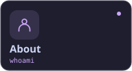</a>
  <a href="#projects">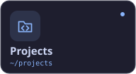</a>
  <a href="#tech-stack">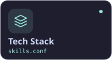</a>
  <a href="#experience">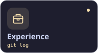</a>
  <br>
  <a href="#workspace">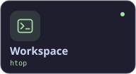</a>
  <a href="#activity">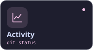</a>
  <a href="#contact">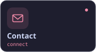</a>
  <a href="https://bfirstkok.me">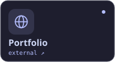</a>
  <br>
  <a href="#career">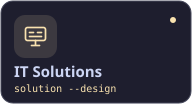</a>
  <a href="#homelab">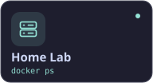</a>
  <a href="#ai-lab">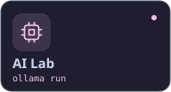</a>
  <a href="#education">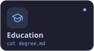</a>
</div>

> **Welcome to my workspace.** Click an application tile to jump to its section, then click the terminal command to expand its contents. Individual projects also have their own expandable panels.

---

## About

<details open>
<summary><b>🖥️ &nbsp; whoami</b> &nbsp; — &nbsp; click to open / close</summary>

<table>
<tr>
<td width="34%" align="center" valign="top">

</td>
<td width="66%" valign="top" align="left">
<b>👨‍💻 Backend Developer · DevOps Enthusiast · IT Pre-sales</b><br>
<span>Connecting software engineering, infrastructure, and business requirements.</span><br><br>
🎓 Computer Engineering Student<br>
🏫 Rajamangala University of Technology Isan, Khon Kaen Campus<br>
💻 Interested in Backend Development, DevOps, and System Infrastructure<br>
🐳 Working with Docker, Linux, web servers, databases, and REST APIs<br>
🛠️ Building web applications and internal management systems<br>
🌐 Experienced with full-stack, IoT, networking, and embedded systems<br>
🚀 Learning CI/CD, cloud infrastructure, automation, and deployment<br>
🎯 Goal: Build reliable systems that solve real-world problems<br>
✨ I enjoy combining engineering, technology, and creative design<br>
🧪 Exploring self-hosted systems, local AI, enterprise networking, and automation<br>
🇹🇭 Based in Thailand
</td>
</tr>
</table>

### Personal profile — `cat ~/.profile`

```yaml
name: Khanathippakorn Namthachak
nickname: First
handle: bfirstkok
education: Computer Engineering
university: RMUTI, Khon Kaen Campus
interests:
  - Backend engineering and DevOps
  - IT solution design and pre-sales
  - Enterprise networking and infrastructure
  - Self-hosting, local AI and automation
  - Cybersecurity, IoT and embedded systems
languages: Thai, English (learning)
motto: Code, Build, Deploy, Monitor, Improve.
```

I enjoy understanding how a system works end to end — from application logic and databases to networks, deployment, and operations. My goal is to turn real-world requirements into practical, maintainable solutions and to keep learning through hands-on projects and experimentation.

[↑ Return to desktop](#desktop)

</details>

## Projects

<details>
<summary><b>🖥️ &nbsp; ls -la ~/projects</b> &nbsp; — &nbsp; click to open / close</summary>

<details>
<summary><b>🏥 Patient Monitoring & Queue Management System</b></summary>

An academic healthcare software prototype for patient workflows, hospital queues, vital signs and AI-assisted triage decision support. Not clinically validated.

- Patient registration and queue management
- Critical-patient monitoring
- IoT vital-sign integration through REST API
- AI-assisted patient assessment
- Role-based interfaces for medical staff
- Backend and database system integration

**Technologies:** Django, Python, PostgreSQL, REST API, JavaScript, IoT

</details>

<details>
<summary><b>📦 NTJ Engineering Store Management System</b></summary>

An internal inventory and material-management system developed for
engineering and construction operations.

- Product and construction-material management
- Stock receiving and issuing
- Inventory balance monitoring
- User and permission management
- Dashboard and operational reports
- Database-backed internal workflow

**Technologies:** Django, Python, PostgreSQL, Bootstrap, JavaScript

</details>

<details>
<summary><b>🛒 Point of Sale Management System</b></summary>

A web-based POS system designed for product, order, and sales management.

- Product and category management
- Order and transaction processing
- Inventory updates
- User authentication and authorization
- Sales summary dashboard
- Backend and database integration

**Technologies:** Django, Python, PostgreSQL, JavaScript, Bootstrap

</details>

<details>
<summary><b>💊 Smart Medicine Storage Room</b></summary>

An IoT and Digital Twin system for monitoring environmental conditions
inside a medicine storage room.

- ESP32-based sensor monitoring
- Temperature and humidity tracking
- Real-time dashboard
- Digital Twin simulation
- REST API communication
- Storage-condition notifications

**Technologies:** ESP32, Arduino, REST API, IoT, Digital Twin

</details>

<details>
<summary><b>🤖 Local AI Assistant Project</b></summary>

A local AI chatbot designed to run with a locally hosted language model.

- Local model execution with Ollama
- Thai-language interaction
- Backend API integration
- Privacy-focused local deployment
- Knowledge-based assistant experiments

**Technologies:** Python, Ollama, REST API, Local LLM

</details>

<details>
<summary><b>🔐 Cybersecurity CTF Practice</b></summary>

Hands-on cybersecurity labs covering web exploitation, enumeration,
privilege escalation, and security analysis.

**Tools:** Kali Linux, Nmap, Gobuster, ffuf, Hydra, sqlmap, Nikto,
Netcat, LinPEAS, pspy, ExifTool, Binwalk, and Steghide

</details>

[↑ Return to desktop](#desktop)

</details>

## Tech Stack

<details>
<summary><b>🖥️ &nbsp; cat /etc/skills.conf</b> &nbsp; — &nbsp; click to open / close</summary>

<table>
  <tr>
    <td width="68%" valign="top">

<b>⚙️ DevOps & Infrastructure</b>

<p>
  
</p>

<p>
  
  
  
  
</p>

<b>🖥️ Backend Development</b>

<p>
  
</p>

<b>🎨 Frontend & Mobile Development</b>

<p>
  
</p>

<b>🗄️ Databases</b>

<p>
  
</p>

<p>
  
</p>

<b>🛠️ Development Tools</b>

<p>
  
</p>

<p>
  
  
  
  
</p>

<b>🔌 IoT, Embedded Systems & Networking</b>

<p>
  
</p>

<p>
  
  
  
  
</p>

<b>🔐 Cybersecurity</b>

<p>
  
</p>

<p>
  
  
  
</p>

<b>🌐 CMS & Local Platforms</b>

<p>
  
</p>

<p>
  
</p>

  </td>

  <td width="32%" align="center" valign="top">
    
    <br><br>
    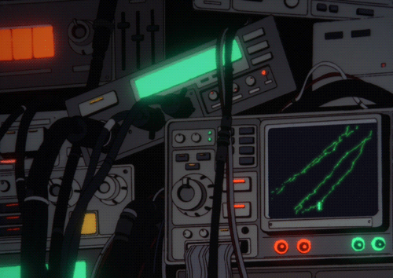
  </td>
  </tr>
</table>

[↑ Return to desktop](#desktop)

</details>

## Experience

<details>
<summary><b>🖥️ &nbsp; git log --oneline</b> &nbsp; — &nbsp; click to open / close</summary>

<table width="100%">
<tr>
<td width="78%" valign="top">
<b>Full-Stack Web Developer — NTJ Engineering Store Management System</b><br>
Developed an internal inventory and construction-material management system, including product records, stock movement, permissions, dashboards, and database integration.
</td>
<td width="22%" align="right" valign="top">
<b>Apr. 2026</b>
</td>
</tr>
<tr>
<td width="78%" valign="top">
<b>Full-Stack Web Developer — POS System</b><br>
Developed a web-based point-of-sale system for managing products, orders, stock, users, and sales information.
</td>
<td width="22%" align="right" valign="top">
<b>Apr. 2026</b>
</td>
</tr>
<tr>
<td width="78%" valign="top">
<b>Full-Stack Developer — Bonlabofficial Graduation Project</b><br>
Collaborated on a critical-patient monitoring and queue management platform. Worked on system implementation, REST API integration, backend functionality, and production support.
</td>
<td width="22%" align="right" valign="top">
<b>Mar. 2025</b>
</td>
</tr>
<tr>
<td width="78%" valign="top">
<b>Web Developer — Mechanical Engineering Website</b><br>
Developed and improved a website for the Mechanical Engineering program, including content structure, interface design, and responsive web pages.
</td>
<td width="22%" align="right" valign="top">
<b>Mar. 2025</b>
</td>
</tr>
<tr>
<td width="78%" valign="top">
<b>Pcampus Studio — Data Dictionary</b><br>
Designed database structures and prepared Data Dictionary documentation for a pharmacy management platform. Worked on field definitions, data types, variable mapping, and database planning.
</td>
<td width="22%" align="right" valign="top">
<b>Feb. 2022</b>
</td>
</tr>
</table>

[↑ Return to desktop](#desktop)

</details>

## Workspace

<details>
<summary><b>🖥️ &nbsp; htop</b> &nbsp; — &nbsp; click to open / close</summary>

<p align="center">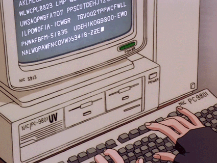</p>

### Active tasks — `jobs`

- Backend development with Django and PostgreSQL
- Dockerized web application environments
- Linux server and web server configuration
- Hospital queue and patient-monitoring systems
- Internal POS and inventory-management systems
- REST API integration for web and IoT applications
- DevOps, CI/CD, and deployment fundamentals
- Enterprise networking and IT solution research
- Local AI agents and workflow automation
- Personal home lab and self-hosted services

### Learning queue — `cat learning.md`

- CI/CD pipeline design and deployment automation
- Docker Compose and containerized application architecture
- Linux server administration
- Cloud infrastructure and application deployment
- Monitoring, logging, and system observability
- Secure backend and REST API development
- PostgreSQL database administration
- Infrastructure and network security fundamentals

[↑ Return to desktop](#desktop)

</details>

## Career

<details>
<summary><b>🖥️ &nbsp; solution --design</b> &nbsp; — &nbsp; IT Pre-sales & Solution Engineering</summary>

### 💼 IT Pre-sales & Solution Engineering

My current professional learning and work focus connects customer requirements with practical IT solutions.

| Area | Activities |
| --- | --- |
| Requirement analysis | Understand customer needs, constraints and existing infrastructure |
| Solution design | Explore network, wireless, server and software architectures |
| Product evaluation | Compare technical specifications, interoperability and lifecycle information |
| Commercial support | Assist with bills of materials, quotations and technical documentation |
| Troubleshooting | Investigate connectivity, DHCP, VLAN, wireless and device-related issues |
| Automation | Explore AI-assisted workflows for pre-sales and technical support |

**Technologies and platforms I work with or explore:** Cisco, HPE Aruba Networking, Ubiquiti UniFi, Docker, Portainer, Windows Server, Linux, and infrastructure management tools.

```text
Requirements → Technical research → Solution design
             → Compatibility check → BOM / proposal
             → Validation and technical support
```

[↑ Return to desktop](#desktop)

</details>

## Home Lab

<details>
<summary><b>🖥️ &nbsp; docker ps</b> &nbsp; — &nbsp; Self-hosted infrastructure</summary>

### 🖥️ Personal Home Lab

I experiment with running my own infrastructure, deploying applications and learning how production-like environments operate.

| Layer | Tools and focus |
| --- | --- |
| Operating systems | Ubuntu Server, Windows Server, WSL |
| Containers | Docker, Docker Compose |
| Web serving | Caddy, Nginx, Apache, IIS |
| Application services | Django, Gunicorn, Next.js |
| Storage and databases | PostgreSQL, SQLite, private storage experiments |
| Operations | SSH, backups, migrations, reverse proxy, TLS and service monitoring |
| Cloud exploration | DigitalOcean and AWS |

```text
              HOME LAB / CONCEPTUAL ARCHITECTURE

                     HTTPS clients
                           |
                    Reverse proxy
                      /        \\
               Web services    Dashboard*
                      |
                  PostgreSQL
                      |
                 Backups / storage

              * Dashboard is an ongoing goal.
```

**Hands-on experiments:** migrating a containerized web application from a cloud VM to a self-hosted environment, restoring PostgreSQL databases, and configuring application deployment and reverse proxies.

**Next steps:** unified service dashboard, automated backups, observability and secure remote access.

[↑ Return to desktop](#desktop)

</details>

## AI Lab

<details>
<summary><b>🖥️ &nbsp; ollama run</b> &nbsp; — &nbsp; Local AI and automation</summary>

### 🤖 AI & Automation Lab

I explore AI systems that combine local models, developer tools, knowledge bases and practical workflow automation.

| Project / experiment | Focus |
| --- | --- |
| Misaki AI | Local AI assistant, Ollama, embeddings and personal knowledge-base experiments |
| Korin AI | Desktop assistant experiments, Thai voice interaction and computer-control workflows |
| IT Pre-sales Copilot | AI-assisted requirement analysis and solution planning |
| IT Troubleshooting Expert | Structured IT troubleshooting and knowledge-base design |
| Quotation Agent | Template-based quotations and BOM workflow automation |

**Tools:** Python, Ollama, REST APIs, local LLMs, embeddings, AI coding assistants and OpenAI-compatible APIs.

**Current interests:** retrieval-augmented generation (RAG), tool calling, local-first AI, developer productivity and responsible automation.

These are personal projects, prototypes and agent concepts rather than claims of production-ready commercial services.

[↑ Return to desktop](#desktop)

</details>

## Education

<details>
<summary><b>🖥️ &nbsp; cat degree.md</b> &nbsp; — &nbsp; Computer Engineering & research</summary>

### 🎓 Computer Engineering

**Rajamangala University of Technology Isan — Khon Kaen Campus, Thailand**

Academic interests include software engineering, database systems, computer networking, embedded systems, IoT and applied AI.

#### Capstone — Critical Patient Monitoring and Nursing Queue Management System

A research and development project combining a Django-based hospital workflow, PostgreSQL, IoT telemetry, a patient portal and AI-assisted triage.

- Patient registration, vital-sign recording and nursing queue management.
- Critical-patient monitoring and threshold-based alerts.
- Integration of web applications, REST APIs and IoT devices.
- Machine-learning experimentation for triage decision support.
- Containerized deployment and relational database management.

**Research status:** Academic prototype; AI suggestions require human review and are not a clinically validated diagnostic or triage service.

#### Learning beyond the classroom

Hands-on networking labs, cybersecurity CTF exercises, server administration, containerization, and real-world application development.

[↑ Return to desktop](#desktop)

</details>

## Activity

<details>
<summary><b>🖥️ &nbsp; git status</b> &nbsp; — &nbsp; click to open / close</summary>

<div align="center">


<br><br>


</div>

[↑ Return to desktop](#desktop)

</details>

## Contact

<details>
<summary><b>🖥️ &nbsp; ssh bfirstkok@world</b> &nbsp; — &nbsp; click to open / close</summary>

<p align="center">
  
</p>

<p align="center">
  Feel free to reach out for collaboration, projects, or technology discussions ♡
</p>

<p align="center">
  ~ open a new connection ~
</p>

<p align="center">
  <a href="mailto:bfirstkok@gmail.com">
    
  </a>

  <a href="https://www.instagram.com/b_first_kok/">
    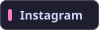
  </a>

  <a href="https://github.com/bfirstkok">
    
  </a>

  <a href="https://www.facebook.com/khanathippakorn.namthachak/">
    
  </a>

  <a href="https://bfirstkok.me">
    
  </a>
</p>

<p align="center">
  <a href="https://data-card-for-spotify.herokuapp.com/card?user_id=31g2rocxd2hqb5snxb55meh543su">
    
  </a>
</p>

[↑ Return to desktop](#desktop)

</details>

---

<div align="center">

**SESSION COMPLETE · THANKS FOR VISITING**

`bfirstkok@linux:~$ exit`

Code, Build, Deploy, Monitor, Improve.

૮ ˶ᵔ ᵕ ᵔ˶ ა

[Back to desktop](#desktop) · [Browse repositories](https://github.com/bfirstkok?tab=repositories) · [Portfolio](https://bfirstkok.me)

</div>
