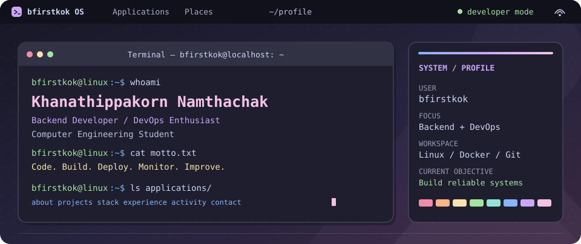

<!-- Linux-inspired GitHub profile. Native details menus; no JavaScript required. -->
# Desktop

  

  

   
  
  
  

### Applications · launcher

 

> **Welcome to my workspace.** Select an application below to open its window, or use the launcher to jump to a section. Each project also has its own expandable panel.

---

## About

<b>🖥️ &nbsp; whoami</b> &nbsp; — &nbsp; click to open / close

<table>
<tr>
<td width="34%" align="center" valign="top">

</td>
<td width="66%" valign="top" align="left">
<b>👨‍💻 Backend Developer & DevOps Enthusiast</b> 
Building, deploying, and improving reliable systems.  
🎓 Computer Engineering Student 
🏫 Rajamangala University of Technology Isan, Khon Kaen Campus 
💻 Interested in Backend Development, DevOps, and System Infrastructure 
🐳 Working with Docker, Linux, web servers, databases, and REST APIs 
🛠️ Building web applications and internal management systems 
🌐 Experienced with full-stack, IoT, networking, and embedded systems 
🚀 Learning CI/CD, cloud infrastructure, automation, and deployment 
🎯 Goal: Build reliable systems that solve real-world problems 
✨ I enjoy combining engineering, technology, and creative design
</td>
</tr>
</table>

[↑ Return to desktop](#desktop)

## Projects

<b>🖥️ &nbsp; ls -la ~/projects</b> &nbsp; — &nbsp; click to open / close

<b>🏥 Patient Monitoring & Queue Management System</b>

A smart healthcare platform for managing patients, hospital queues,
vital signs, and AI-assisted triage.

- Patient registration and queue management
- Critical-patient monitoring
- IoT vital-sign integration through REST API
- AI-assisted patient assessment
- Role-based interfaces for medical staff
- Backend and database system integration

**Technologies:** Django, Python, PostgreSQL, REST API, JavaScript, IoT

<b>📦 NTJ Engineering Store Management System</b>

An internal inventory and material-management system developed for
engineering and construction operations.

- Product and construction-material management
- Stock receiving and issuing
- Inventory balance monitoring
- User and permission management
- Dashboard and operational reports
- Database-backed internal workflow

**Technologies:** Django, Python, PostgreSQL, Bootstrap, JavaScript

<b>🛒 Point of Sale Management System</b>

A web-based POS system designed for product, order, and sales management.

- Product and category management
- Order and transaction processing
- Inventory updates
- User authentication and authorization
- Sales summary dashboard
- Backend and database integration

**Technologies:** Django, Python, PostgreSQL, JavaScript, Bootstrap

<b>💊 Smart Medicine Storage Room</b>

An IoT and Digital Twin system for monitoring environmental conditions
inside a medicine storage room.

- ESP32-based sensor monitoring
- Temperature and humidity tracking
- Real-time dashboard
- Digital Twin simulation
- REST API communication
- Storage-condition notifications

**Technologies:** ESP32, Arduino, REST API, IoT, Digital Twin

<b>🤖 Local AI Assistant Project</b>

A local AI chatbot designed to run with a locally hosted language model.

- Local model execution with Ollama
- Thai-language interaction
- Backend API integration
- Privacy-focused local deployment
- Knowledge-based assistant experiments

**Technologies:** Python, Ollama, REST API, Local LLM

<b>🔐 Cybersecurity CTF Practice</b>

Hands-on cybersecurity labs covering web exploitation, enumeration,
privilege escalation, and security analysis.

**Tools:** Kali Linux, Nmap, Gobuster, ffuf, Hydra, sqlmap, Nikto,
Netcat, LinPEAS, pspy, ExifTool, Binwalk, and Steghide

[↑ Return to desktop](#desktop)

## Tech Stack

<b>🖥️ &nbsp; cat /etc/skills.conf</b> &nbsp; — &nbsp; click to open / close

<table>
  <tr>
    <td width="68%" valign="top">

<b>⚙️ DevOps & Infrastructure</b>

  

  
  
  
  

<b>🖥️ Backend Development</b>

  

<b>🎨 Frontend & Mobile Development</b>

  

<b>🗄️ Databases</b>

  

  

<b>🛠️ Development Tools</b>

  

  
  
  
  

<b>🔌 IoT, Embedded Systems & Networking</b>

  

  
  
  
  

<b>🔐 Cybersecurity</b>

  

  
  
  

<b>🌐 CMS & Local Platforms</b>

  

  

  </td>

  <td width="32%" align="center" valign="top">
    
      
    
  </td>
  </tr>
</table>

[↑ Return to desktop](#desktop)

## Experience

<b>🖥️ &nbsp; git log --oneline</b> &nbsp; — &nbsp; click to open / close

<table width="100%">
<tr>
<td width="78%" valign="top">
<b>Full-Stack Web Developer — NTJ Engineering Store Management System</b> 
Developed an internal inventory and construction-material management system, including product records, stock movement, permissions, dashboards, and database integration.
</td>
<td width="22%" align="right" valign="top">
<b>Apr. 2026</b>
</td>
</tr>
<tr>
<td width="78%" valign="top">
<b>Full-Stack Web Developer — POS System</b> 
Developed a web-based point-of-sale system for managing products, orders, stock, users, and sales information.
</td>
<td width="22%" align="right" valign="top">
<b>Apr. 2026</b>
</td>
</tr>
<tr>
<td width="78%" valign="top">
<b>Full-Stack Developer — Bonlabofficial Graduation Project</b> 
Collaborated on a critical-patient monitoring and queue management platform. Worked on system implementation, REST API integration, backend functionality, and production support.
</td>
<td width="22%" align="right" valign="top">
<b>Mar. 2025</b>
</td>
</tr>
<tr>
<td width="78%" valign="top">
<b>Web Developer — Mechanical Engineering Website</b> 
Developed and improved a website for the Mechanical Engineering program, including content structure, interface design, and responsive web pages.
</td>
<td width="22%" align="right" valign="top">
<b>Mar. 2025</b>
</td>
</tr>
<tr>
<td width="78%" valign="top">
<b>Pcampus Studio — Data Dictionary</b> 
Designed database structures and prepared Data Dictionary documentation for a pharmacy management platform. Worked on field definitions, data types, variable mapping, and database planning.
</td>
<td width="22%" align="right" valign="top">
<b>Feb. 2022</b>
</td>
</tr>
</table>

[↑ Return to desktop](#desktop)

## Workspace

<b>🖥️ &nbsp; htop</b> &nbsp; — &nbsp; click to open / close

### Active tasks — `jobs`

- Backend development with Django and PostgreSQL
- Dockerized web application environments
- Linux server and web server configuration
- Hospital queue and patient-monitoring systems
- Internal POS and inventory-management systems
- REST API integration for web and IoT applications
- DevOps, CI/CD, and deployment fundamentals

### Learning queue — `cat learning.md`

- CI/CD pipeline design and deployment automation
- Docker Compose and containerized application architecture
- Linux server administration
- Cloud infrastructure and application deployment
- Monitoring, logging, and system observability
- Secure backend and REST API development
- PostgreSQL database administration
- Infrastructure and network security fundamentals

[↑ Return to desktop](#desktop)

## Activity

<b>🖥️ &nbsp; git status</b> &nbsp; — &nbsp; click to open / close

  

[↑ Return to desktop](#desktop)

## Contact

<b>🖥️ &nbsp; ssh bfirstkok@world</b> &nbsp; — &nbsp; click to open / close

  

  Feel free to reach out for collaboration, projects, or technology discussions ♡

  ~ open a new connection ~

  

  

  

  

  

  

[↑ Return to desktop](#desktop)

---

**SESSION COMPLETE · THANKS FOR VISITING**

`bfirstkok@linux:~$ exit`

Code, Build, Deploy, Monitor, Improve.

૮ ˶ᵔ ᵕ ᵔ˶ ა

[Back to desktop](#desktop) · [Browse repositories](https://github.com/bfirstkok?tab=repositories) · [Portfolio](https://bfirstkok.me)

